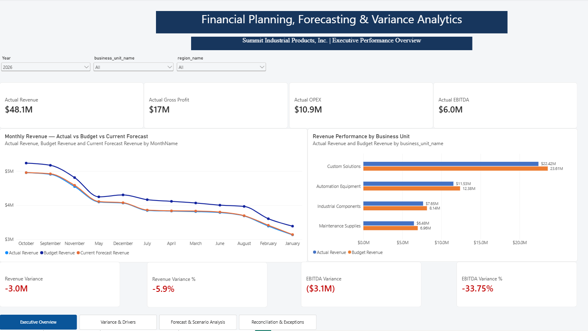
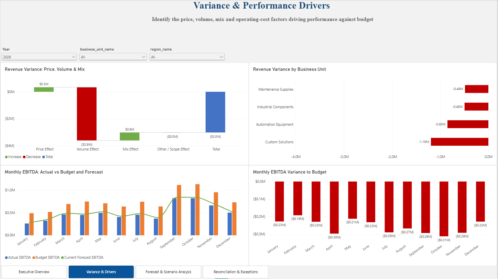
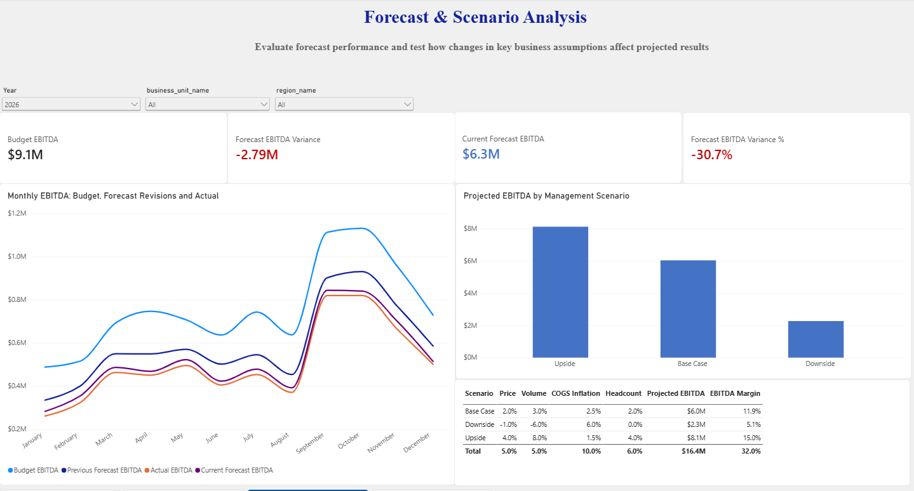
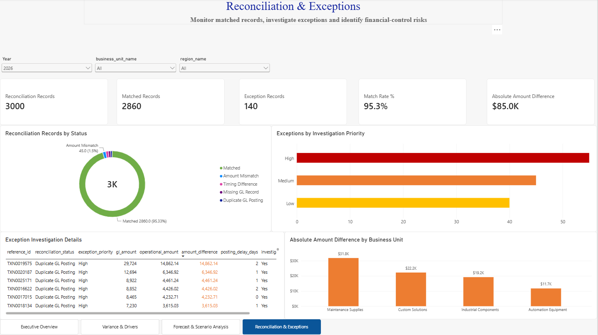

# Financial Planning, Forecasting & Variance Analytics

## FP&A Decision-Support System

An end-to-end financial analytics project developed for **Summit Industrial Products, Inc.**, a fictional U.S. industrial-products company.

The system integrates **Python, SQL, Excel and Power BI** to help management evaluate financial performance, investigate budget variances, update forecasts, reconcile financial records and analyze business scenarios.

---

## Business Problem

Management needs reliable answers to questions such as:

- Why did revenue and EBITDA differ from budget?
- Which business units drove the variance?
- Was the revenue variance caused by price, volume or product mix?
- Which operating-expense categories exceeded plan?
- How does the current forecast compare with the original budget?
- How would changes in price, volume, COGS inflation and headcount affect projected EBITDA?
- Which financial records require investigation?

---

## Analytical Workflow

```text
Public economic data + Synthetic company data
                    ↓
          Python data preparation
                    ↓
             SQL analytics layer
                    ↓
          Excel financial reporting
                    ↓
       Power BI management dashboard
```

The company-level financial data is synthetic and designed to represent realistic FP&A processes. Public macroeconomic indicators from Federal Reserve Economic Data provide additional economic context.

---

## Dashboard Pages

### 1. Executive Overview



The executive overview summarizes:

- Actual and budget revenue
- Revenue variance
- Gross profit and gross margin
- Operating expenses
- EBITDA performance
- Monthly financial trends
- Business-unit performance

### 2. Variance & Drivers



This page provides:

- Price-volume-mix analysis
- Revenue variance by business unit
- Monthly EBITDA comparisons
- Operating-expense analysis
- Favorable and unfavorable variance identification
- Budget, actual and forecast comparisons

Revenue variance is decomposed into:

- Price effect
- Volume effect
- Mix effect
- Other or scope effect

### 3. Forecast & Scenario Analysis



This page compares:

- Original budget
- Previous forecast
- Current forecast
- Actual performance

Management scenarios evaluate how changes in the following assumptions affect projected EBITDA:

- Price
- Sales volume
- COGS inflation
- Headcount

The page includes upside, base-case and downside scenarios.

### 4. Reconciliation & Exceptions



This page monitors:

- Matched records
- Amount mismatches
- Timing differences
- Missing general-ledger records
- Duplicate general-ledger postings
- Investigation priorities
- Amount differences by business unit

The exception table provides transaction-level details to support investigation.

---

## Key Results

| KPI | Result |
|---|---:|
| Budget EBITDA | $9.1M |
| Current Forecast EBITDA | $6.3M |
| Forecast EBITDA Variance | -$2.79M |
| Forecast EBITDA Variance % | -30.7% |
| Reconciliation Records | 3,000 |
| Matched Records | 2,860 |
| Exception Records | 140 |
| Match Rate | 95.3% |
| Absolute Amount Difference | Approximately $85K |

---

## Key Features

- Budget-versus-actual analysis
- Budget-versus-forecast analysis
- Revenue price-volume-mix decomposition
- EBITDA and gross-margin analysis
- Business-unit and regional reporting
- Rolling forecast comparisons
- Management scenario analysis
- Financial-record reconciliation
- Exception classification and prioritization
- Interactive Power BI slicers
- Cross-page filter synchronization
- Dashboard page navigation
- Power BI-ready star-schema data model

---

## Data

The project combines synthetic corporate data with public economic indicators.

### Synthetic Corporate Data

The synthetic company dataset includes:

- Revenue and units sold
- Product prices
- Cost of goods sold
- Gross profit
- Operating expenses
- EBITDA
- Business units
- Products
- Regions
- Customer segments
- Actual results
- Original budget
- Previous forecast
- Current forecast
- General-ledger records
- Operational records
- Reconciliation results

### Public Economic Data

Public macroeconomic indicators from **Federal Reserve Economic Data (FRED)** provide external economic context for planning and forecasting.

The synthetic company data does not represent any real organization.

---

## Tools and Technologies

- Python
- pandas
- NumPy
- SQL
- SQLite
- Microsoft Excel
- Power BI
- DAX
- Power Query
- Google Colab / Jupyter Notebook
- Federal Reserve Economic Data

---

## Project Files

| File | Description |
|---|---|
| `fpa-financial-planning-variance-analytics.ipynb` | Complete Python analytics workflow |
| `Summit_Industrial_FP&A_Dashboard.pbix` | Interactive Power BI dashboard |
| `Summit_Industrial_FP&A_Analytics.xlsx` | Financial-analysis workbook |
| `Summit_Industrial_PowerBI_Data_Model.xlsx` | Power BI-ready analytical data model |
| `fpa_sql_analytics_layer.zip` | SQL database and analytical layer |
| `fpa_analytics_exports.zip` | Exported analytical datasets |
| `images/` | Power BI dashboard screenshots |

---

## Reconciliation Logic

Financial records are classified into categories such as:

- Matched
- Amount mismatch
- Timing difference
- Missing general-ledger record
- Duplicate general-ledger posting
- Requires investigation

Exceptions are assigned investigation priorities to help analysts focus on the most important financial-control risks.

---

## Business Value

This project demonstrates how an analyst can move beyond static reporting by connecting financial results to business explanations and management actions.

The system supports:

- Monthly management reporting
- Budget accountability
- Forecast updates
- Profitability analysis
- Scenario planning
- Financial reconciliation
- Exception investigation
- Internal financial controls
- Evidence-based decision-making

---

## Skills Demonstrated

- Financial planning and analysis
- Budgeting and forecasting
- Variance analysis
- Price-volume-mix analysis
- Profitability and margin analysis
- Financial reconciliation
- Exception monitoring
- SQL data modeling
- Python analytics
- Excel reporting
- Power BI development
- DAX measure development
- Business storytelling
- Management decision support

---

## Author

**Gerald Hlabiso**  
M.S. Business Analytics Candidate  
Saint Louis University

[View my analytics portfolio](https://gerald-hlabiso.github.io/business-analytics-portfolio/)
